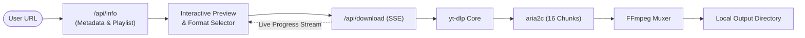

# ⚡ YTDL — High-Speed YouTube Video & Playlist Downloader

<p align="center">
  
</p>

<p align="center">
  <strong>Ultra-fast, zero-re-encoding YouTube downloader powered by Next.js 16 (Turbopack), React 19, <code>yt-dlp</code>, and <code>aria2c</code> multi-connection parallel acceleration.</strong>
</p>

<p align="center">
  
  
  
  
  
  
</p>

---

## ✨ Features

- ⚡ **16x Parallel Download Acceleration**: Multi-connection chunking with `aria2c` (`-x 16 -s 16 -k 1M`) delivers maximum ISP throughput.
- 🎬 **Up to 4K & 8K 60FPS Video**: Downloads pristine adaptive video streams and merges them losslessly with uncompressed audio via FFmpeg (`-c copy`).
- 🎵 **High-Bitrate Audio Extraction**: One-click audio ripping in **MP3 (320kbps)**, **FLAC (Master Lossless)**, **Opus**, **M4A/AAC**, and **WAV**.
- 📑 **Complete Playlist Batch Downloader**:
  - Instantaneous tracklist metadata extraction using `--flat-playlist`.
  - Preview full video list with thumbnails, durations, channel names, and indices.
  - Live per-item download queue featuring active glowing spinners, per-video progress bars, and percentage badges.
  - Automatically organizes downloads into dedicated playlist subfolders.
- 📡 **Real-time Server-Sent Events (SSE)**: Live streaming of download speed (MB/s), estimated time remaining (ETA), total file size, and interactive terminal logs.
- 🎨 **Cyber/Glassmorphic Aesthetic**: Bespoke dark interface styled with Vanilla CSS tokens, Inter & JetBrains Mono typography, animated glow effects, and zero generic UI component bloat.
- 🔍 **SEO & Core Web Vitals Ready**:
  - Dynamic `sitemap.xml` and `robots.txt` via Next.js metadata routes.
  - Preconnect resource hints for sub-second LCP.
  - Schema.org structured data (`WebApplication`, `FAQPage`, `HowTo` JSON-LD).

---

## 🛠️ Tech Stack & Architecture

| Layer | Technology | Purpose |
| :--- | :--- | :--- |
| **Frontend** | Next.js 16 (App Router) + React 19 | Server & Client Components with Turbopack |
| **Language** | TypeScript | Strict type safety across media formats and SSE events |
| **Styles** | Vanilla CSS Tokens | Zero runtime CSS-in-JS overhead, glassmorphism, responsive |
| **Downloader** | `yt-dlp` | Active YouTube extraction engine bypassing throttling |
| **Speed Accelerator** | `aria2c` | Downloads video fragments across up to 16 parallel connections |
| **Muxer** | `FFmpeg` | Merges video/audio streams losslessly and embeds metadata/thumbnails |
| **Streaming** | Server-Sent Events (SSE) | Real-time progress piping from CLI process to React state |



---

## 🚀 Quick Start

### 1. Prerequisites

YTDL requires the following media processing engines available in your system `PATH` or placed in `./bin/`:

#### Windows (Recommended via winget):
```powershell
winget install yt-dlp
winget install ffmpeg
winget install aria2
```

#### macOS (via Homebrew):
```bash
brew install yt-dlp ffmpeg aria2
```

#### Linux (Debian / Ubuntu):
```bash
sudo apt update && sudo apt install ffmpeg aria2
sudo wget https://github.com/yt-dlp/yt-dlp/releases/latest/download/yt-dlp -O /usr/local/bin/yt-dlp
sudo chmod a+rx /usr/local/bin/yt-dlp
```

### 2. Installation

```bash
# Clone the repository
git clone https://github.com/khushal-mali/youtube-downloader.git
cd youtube-downloader

# Install Node dependencies
npm install

# Start the Turbopack development server
npm run dev
```

Open [http://localhost:3000](http://localhost:3000) in your browser.

---

## 📂 Project Structure

```text
youtube-downloader/
├── bin/                          # Optional standalone executables (yt-dlp.exe, aria2c.exe)
├── src/
│   ├── app/
│   │   ├── api/
│   │   │   ├── download/route.ts # SSE download stream & child process manager
│   │   │   ├── info/route.ts     # Video/playlist metadata inspector
│   │   │   └── tools/route.ts    # CLI engine detection endpoint
│   │   ├── globals.css           # Design tokens, cyber aesthetics, and glassmorphism
│   │   ├── layout.tsx            # Root layout with SEO metadata & JSON-LD schemas
│   │   ├── page.tsx              # Main interactive UI & download monitor
│   │   ├── robots.ts             # Dynamic robots.txt route
│   │   └── sitemap.ts            # Dynamic sitemap.xml route
│   ├── lib/
│   │   ├── tools.ts              # Engine discovery (yt-dlp, ffmpeg, aria2c)
│   │   └── utils.ts              # Output progress parsers & format helpers
│   └── types/
│       └── index.ts              # TypeScript schemas for formats, events & playlists
├── package.json
├── tsconfig.json
└── README.md
```

---

## ⚙️ Configuration

Environment variables can optionally be configured in `.env.local`:

```env
# Base URL for sitemap and metadata canonical URLs
NEXT_PUBLIC_SITE_URL=https://ytdl.app

# Custom binary override paths (optional, auto-detects from PATH or ./bin)
# YTDLP_PATH=C:\custom\yt-dlp.exe
# FFMPEG_PATH=C:\custom\ffmpeg.exe
# ARIA2C_PATH=C:\custom\aria2c.exe
```

---

## 📄 License

This project is licensed under the [MIT License](LICENSE).
